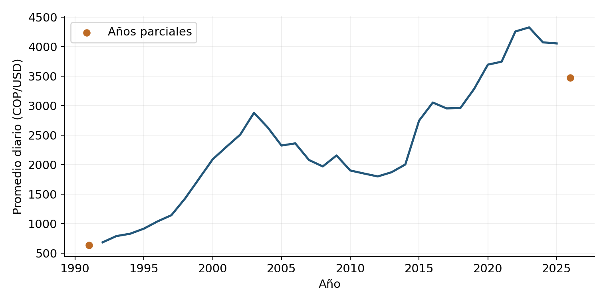
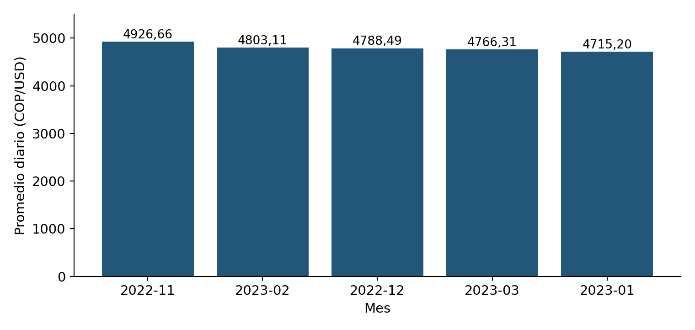
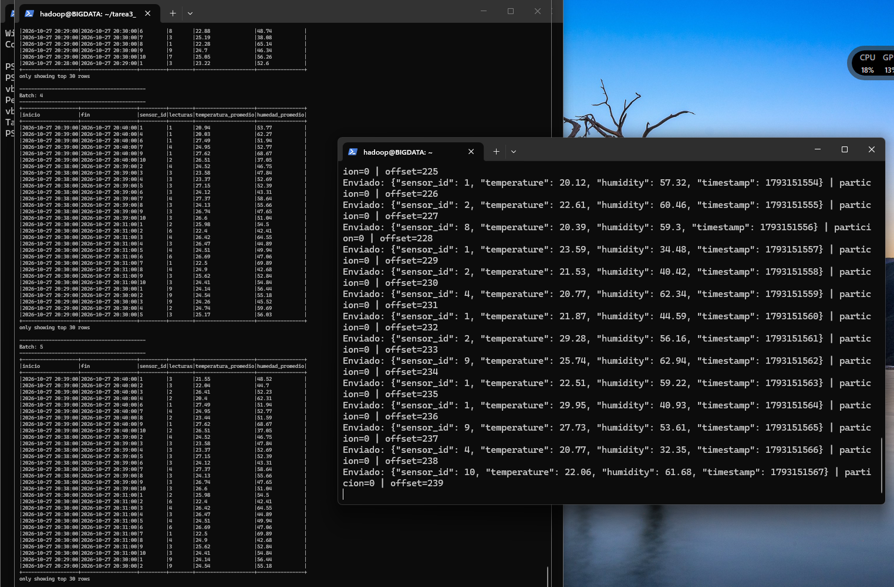
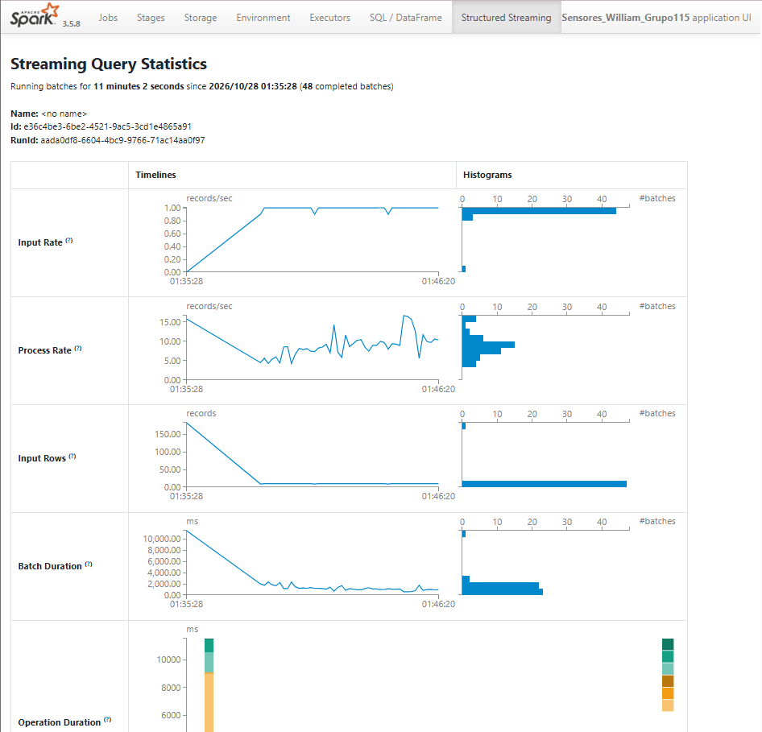

# Tarea 3 — Procesamiento de datos con Apache Spark

William de Jesus Marín Jiménez - Big Data - Código: 202016911 - Grupo 115 - UNAD

Aqui comparto el codigo y resultados de la tarea 3: Procesamiento de Datos con Apache Spark

Análisis histórico de la Tasa de Cambio Representativa del Mercado (TRM) mediante PySpark y HDFS, y procesamiento de sensores simulados con Kafka y Spark Structured Streaming. El código publicado es el mismo que se ejecutó en la máquina virtual BIGDATA. La práctica de sensores se basa en el Anexo 3 del curso.

## Contenido

| Carpeta | Contenido |
|---|---|
| `trm/codigo` | Aplicación batch `analisis_trm.py` |
| `trm/datos` | CSV original descargado el 27 de octubre de 2026 |
| `trm/resultados_verificados` | Cinco CSV generados por Spark; renombrados para facilitar su consulta, sin cambiar su contenido |
| `trm/resultados` | Registro de la ejecución batch |
| `streaming/codigo` | Productor Kafka y consumidor Spark |
| `streaming/configuracion` | Configuraciones de Kafka y ZooKeeper utilizadas |
| `streaming/resultados` | Registros de mensajes enviados y agregaciones |
| `streaming/requirements.txt` | Dependencia del productor: kafka-python 3.0.12 |
| `graficas` | Gráficas del análisis de la TRM |
| `evidencias` | Capturas de la ejecución de streaming |

## Entorno utilizado

- Ubuntu Server 22.04.5 LTS en VirtualBox, usuario `hadoop`.
- Java 11, Python 3.10.12 y Hadoop 3.3.6.
- Spark 3.5.8, Scala 2.12.18, ejecución `local[2]`.
- Kafka 3.9.2 con ZooKeeper, un broker local.
- Conector Spark: `org.apache.spark:spark-sql-kafka-0-10_2.12:3.5.8`.
- `kafka-python==3.0.12` en un entorno virtual para el productor.

Hadoop y Spark deben estar instalados y configurados previamente, con sus comandos disponibles en PATH. Kafka se encuentra en `/home/hadoop/kafka_2.12-3.9.2`. El repositorio no instala estas plataformas ni incluye sus binarios. La primera ejecución del consumidor necesita acceso a Internet para descargar el conector y sus dependencias. No es necesario instalar PySpark con pip: se utiliza la distribución de Spark mediante `spark-submit`.

## Análisis batch de la TRM

### Problema y fuente

¿Cómo ha variado la TRM en Colombia y qué años y meses presentan los mayores y menores valores históricos?

Fuente: Superintendencia Financiera de Colombia, [Tasa de Cambio Representativa del Mercado Histórico](https://www.datos.gov.co/d/mcec-87by), Datos Abiertos Colombia. Se conserva la copia descargada el 27 de octubre de 2026 para reproducir los resultados; una descarga posterior puede cambiar.

El archivo contiene 8.376 registros y cuatro columnas: `VALOR`, `UNIDAD`, `VIGENCIADESDE` y `VIGENCIAHASTA`. Es un conjunto pequeño utilizado para practicar herramientas de Big Data; esta ejecución no demuestra rendimiento a gran escala. La unidad es COP por USD.

### Procedimiento

1. Leer el CSV desde HDFS y convertir tasas y fechas a tipos explícitos.
2. Comprobar valores nulos, duplicados, tasas no positivas, unidades e intervalos inválidos.
3. Aplicar el corte fijo del **27 de octubre de 2026**. Se excluye una vigencia posterior.
4. Expandir cada intervalo de vigencia a días calendario mediante `sequence` y `explode`.
5. Verificar que no existan fechas repetidas ni días faltantes.
6. Calcular estadísticas generales, anuales, mensuales y fechas extremas mediante DataFrames.
7. Guardar cinco salidas CSV y marcar los períodos incompletos.

Los promedios ponderan cada tasa por sus días de vigencia. Los años 1991 y 2026, y los meses diciembre de 1991 y octubre de 2026, son parciales. Las clasificaciones excluyen períodos incompletos.

### Preparación y ejecución

Los siguientes comandos se ejecutan **en Ubuntu como usuario `hadoop`**, desde la carpeta raíz del repositorio. Se conservan las rutas originales del código para que coincida con las evidencias:

```bash
mkdir -p /home/hadoop/tarea3_trm/codigo /home/hadoop/tarea3_trm/datos
cp -n trm/codigo/analisis_trm.py /home/hadoop/tarea3_trm/codigo/
cp -n trm/datos/trm_historico.csv /home/hadoop/tarea3_trm/datos/
```

Si HDFS está detenido, iniciarlo con `start-dfs.sh`. No formatear el NameNode de una instalación existente. Cargar el CSV, solo si todavía no está en la ruta indicada:

```bash
hdfs dfs -mkdir -p /user/hadoop/tarea3/trm
hdfs dfs -test -e /user/hadoop/tarea3/trm/trm_historico.csv || hdfs dfs -put /home/hadoop/tarea3_trm/datos/trm_historico.csv /user/hadoop/tarea3/trm/
```

Ejecutar:

```bash
cd /home/hadoop/tarea3_trm
spark-submit --master 'local[2]' codigo/analisis_trm.py
```

La ejecución termina con `ANALISIS TERMINADO`. Genera las carpetas `serie_diaria`, `resumen_general`, `resumen_anual`, `resumen_mensual` y `fechas_extremas` dentro de `/home/hadoop/tarea3_trm/resultados_automaticos`. Cada carpeta contiene un archivo `part-*.csv` y `_SUCCESS`. El programa sobrescribe estas salidas al repetir la ejecución; los CSV de referencia del repositorio permanecen en `trm/resultados_verificados`.

### Resultados verificados

| Indicador | Resultado |
|---|---:|
| Registros originales | 8.376 |
| Registros posteriores al corte | 1 |
| Registros inválidos / duplicados | 0 / 0 |
| Días de la serie validada | 12.749 |
| Período efectivo | 02/12/1991–27/10/2026 |
| Mínimo | 620,62 COP/USD |
| Máximo | 5.061,21 COP/USD |
| Promedio diario del período | 2.386,13 COP/USD |
| Mayor promedio anual completo | 2023: 4.325,05 COP/USD |
| Mayor promedio mensual completo | Noviembre de 2022: 4.926,66 COP/USD |

El mínimo estuvo vigente del 21 al 23 de diciembre de 1991 y el máximo del 5 al 8 de noviembre de 2022. El análisis es descriptivo y nominal; no realiza pronósticos ni establece causas económicas.





## Kafka y Spark Structured Streaming

### Flujo y análisis

El productor publica un evento JSON aproximadamente cada segundo en `sensor_data`. Simula diez sensores, temperatura entre 20 y 30 °C, humedad entre 30 y 70 % y una marca de tiempo Unix en segundos. Espera la confirmación del broker e imprime partición y offset.

Spark interpreta el JSON con un esquema explícito, convierte los segundos a timestamp y agrupa por sensor y ventana de un minuto. Calcula número de lecturas y promedios de temperatura y humedad. La consulta procesa microlotes cada diez segundos y muestra hasta treinta filas en consola en modo `complete`.

El límite de treinta filas corresponde a la visualización. Los promedios de una ventana todavía abierta cambian al llegar eventos. La zona horaria de las tablas es `America/Bogota`; los registros del sistema y algunas pantallas pueden mostrar UTC.

### Preparación

Desde la raíz del repositorio, en Ubuntu como usuario `hadoop`:

```bash
mkdir -p /home/hadoop/tarea3_streaming/codigo
cp -n streaming/codigo/*.py /home/hadoop/tarea3_streaming/codigo/
cp -n streaming/requirements.txt /home/hadoop/tarea3_streaming/
cp -n streaming/configuracion/*.properties /home/hadoop/kafka_2.12-3.9.2/config/
mkdir -p /home/hadoop/kafka-data/zookeeper /home/hadoop/kafka-data/broker
cd /home/hadoop/tarea3_streaming
python3 -m venv .venv
source .venv/bin/activate
python -m pip install -r requirements.txt
```

Las copias con `cp -n` conservan archivos ya existentes. En la máquina original esta preparación ya está realizada. En otra máquina deben adaptarse todas las rutas absolutas, incluido el checkpoint del consumidor.

### Iniciar los servicios

Si ya están activos, omitir su inicio. Consultar `jps` para comprobar `QuorumPeerMain` y `Kafka`.

```bash
cd /home/hadoop/kafka_2.12-3.9.2
KAFKA_HEAP_OPTS="-Xms128m -Xmx256m" bin/zookeeper-server-start.sh -daemon config/zookeeper-tarea3.properties
```

Esperar a que ZooKeeper escuche en 2181 y luego iniciar Kafka:

```bash
KAFKA_HEAP_OPTS="-Xms256m -Xmx512m" bin/kafka-server-start.sh -daemon config/server-tarea3.properties
```

Verificar que Kafka escuche en 9092 y crear el topic:

```bash
bin/kafka-topics.sh --create --if-not-exists --bootstrap-server localhost:9092 --replication-factor 1 --partitions 1 --topic sensor_data
bin/kafka-topics.sh --describe --bootstrap-server localhost:9092 --topic sensor_data
```

### Ejecutar en dos terminales

**Terminal 1: productor**

```bash
cd /home/hadoop/tarea3_streaming
source .venv/bin/activate
python -u codigo/kafka_producer.py
```

**Terminal 2: consumidor**, en otra sesión del usuario `hadoop`:

```bash
cd /home/hadoop/tarea3_streaming
spark-submit --master 'local[2]' \
  --packages org.apache.spark:spark-sql-kafka-0-10_2.12:3.5.8 \
  codigo/spark_streaming_consumer.py
```

Se esperan mensajes `Enviado:` en el productor y tablas `Batch:` en el consumidor. Al comenzar una consulta nueva, `startingOffsets="earliest"` lee los mensajes disponibles anteriores. Al reanudar con un checkpoint compatible se utiliza el progreso guardado en `/home/hadoop/tarea3_streaming/checkpoints/sensores`.

Para observar Spark desde Windows, con el reenvío SSH de VirtualBox host 2222 → invitado 22, abrir una tercera terminal PowerShell:

```powershell
ssh -N -L 4040:localhost:4040 -p 2222 vboxuser@127.0.0.1
```

Mantenerla abierta y visitar `http://localhost:4040` mientras Spark esté activo. No abrir otro túnel sobre el mismo puerto si ya hay uno funcionando.

### Resultados y cierre

El respaldo contiene **754 mensajes confirmados**, offsets del 0 al 753, y **59 microlotes**, Batch 0 a Batch 58. Las capturas registran, en momentos específicos, 301 tareas completadas y ninguna fallida, y una tasa media de entrada de 0,97 registros/s. Los contadores corresponden a instantes distintos y no deben confundirse con los totales finales.





Para terminar, detener el productor con Ctrl+C, esperar a que Spark procese los últimos eventos y detener el consumidor con Ctrl+C. Si se va a apagar la máquina, detener Kafka antes de ZooKeeper:

```bash
/home/hadoop/kafka_2.12-3.9.2/bin/kafka-server-stop.sh
```

Esperar a que Kafka termine y después ejecutar:

```bash
/home/hadoop/kafka_2.12-3.9.2/bin/zookeeper-server-stop.sh
```

## Validación y límites

La validación batch comprueba registros inválidos, duplicados y continuidad de fechas. Sus resultados automáticos coincidieron con los resultados de la sesión interactiva. La sintaxis de los tres programas se comprobó al preparar este repositorio; las evidencias de ejecución proceden de BIGDATA, no de una nueva ejecución al empaquetarlos.

En streaming se comprobó la recepción de mensajes y la actualización de agregaciones. No aparecen ERROR ni Traceback en los registros respaldados. La salida de consola no contiene todas las filas de todos los grupos y no permite una conciliación exhaustiva de mensajes contra resultados. No se realizaron pruebas de recuperación ni de rendimiento a gran escala. La configuración con una sola réplica no tolera la pérdida del único broker. El modo `complete` conserva el estado de las agregaciones y se utiliza aquí para una demostración acotada; no se presenta como configuración de producción indefinida.

El repositorio no contiene contraseñas, entornos virtuales, binarios de las plataformas, datos internos del broker ni checkpoints. Los registros conservan nombres de usuario y direcciones locales del entorno académico.

## Presentación y videos

Pendientes de incorporar: enlace de la presentación online, video del análisis TRM y video de Kafka y Spark Streaming. Este repositorio reúne el componente individual de William; el informe colaborativo y las contribuciones de Ricardo se gestionan en el documento del grupo.

## Fuentes

- Universidad Nacional Abierta y a Distancia. Guía de aprendizaje — Tarea 3 — Procesamiento de Datos con Apache Spark y Anexo 3 — Instructivo Spark Streaming y Kafka. Material del curso Big Data, 2026.
- Superintendencia Financiera de Colombia. [TRM histórico](https://www.datos.gov.co/d/mcec-87by). Datos Abiertos Colombia.
- Apache Software Foundation. [Kafka 3.9 Quick Start](https://kafka.apache.org/39/getting-started/quickstart/).
- Apache Software Foundation. [Spark 3.5.8 Structured Streaming + Kafka Integration Guide](https://spark.apache.org/docs/3.5.8/structured-streaming-kafka-integration.html).
